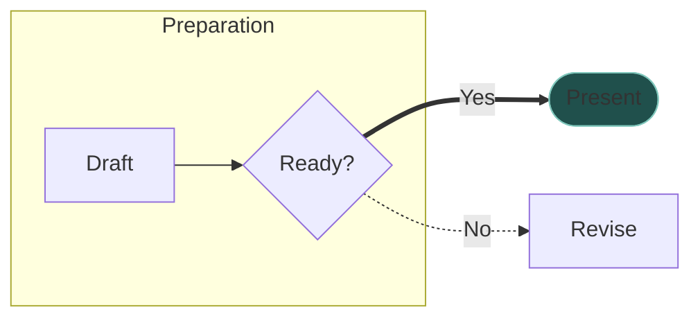
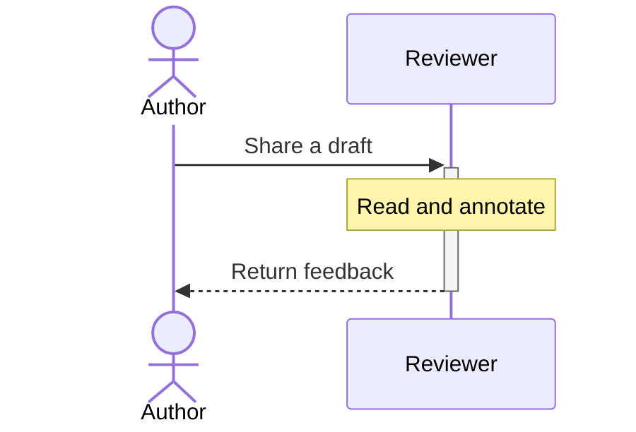
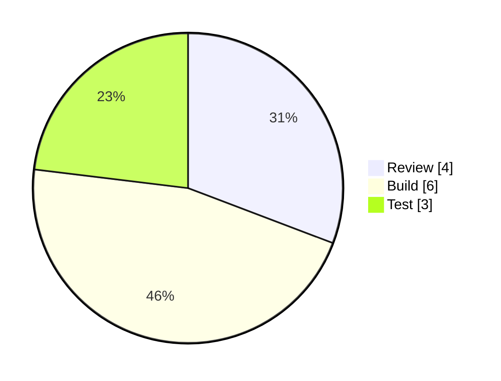
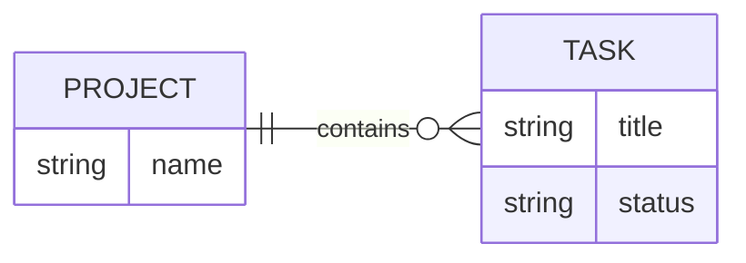
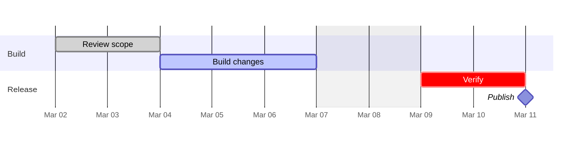
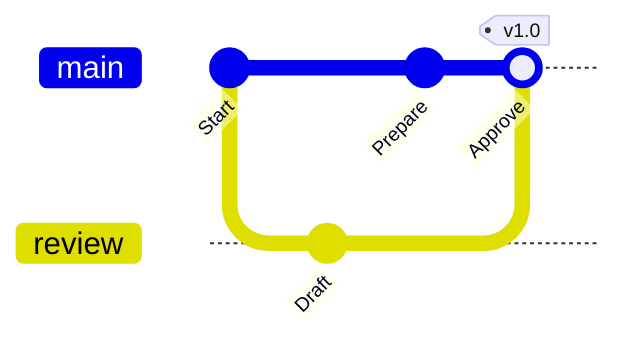

# TypeScript presentations

A Markdown deck you can run in your browser.

<!--
Press P to open the synchronized presenter window.
-->

---

# Write in Markdown

- Use headings, tables, links and speaker notes.
- Put shared images and fonts in the deck’s public directory.
- Add HTML for interaction and CSS for the deck’s theme.

<!--
The source of every slide is in this Markdown file.
-->

---

# Highlight code

```ts
const audience = ['designers', 'developers']
for (const person of audience) {
  console.log(`Hello, ${person}!`)
}
```

<!--
Code highlighting uses the TypeScript highlighter from Stacks.
-->

---
layout: center
routeAlias: reveal
transition: fade

---

# Introduce the idea

<ul>
  <li>Set up the first point.</li>
  <li v-click>Reveal the next point.</li>
  <li v-click>Finish with the decision.</li>
</ul>

<!--
Each press of the next arrow reveals a point.
[click]
Explain the second point.
[click]
Then ask for the decision.
-->

---

# A simple flowchart



<!--
The slide renders the diagram locally with ts-charts.
-->

---

# Live TypeScript

Edit the function and run it in the slide.

```ts {monaco-run}
const distance = (x: number, y: number) => Math.hypot(x, y)
console.log(distance(3, 4))
```

<!--
Change 3 or 4 and run the example again.
-->

---
layout: compare

---

# Vector length

The length of a vector \(v\) is \(\norm{v}\).

::right::

$$
\sqrt{x^2+y^2} = \sqrt{3^2+4^2} = 5
$$

[Browser runtime documentation](https://bun.com/docs/runtime)

<!--
Connect the formula to the preceding live example.
-->

---

# Exchange messages



<!--
Show how the participants, messages and note come from the diagram fence.
-->

---

# Highlight each equation

The first step expands the square. The second gives the result.

$$ {hide|1|2|all}
\begin{aligned}
24^2 &= (20 + 4)^2 \\
     &= 400 + 160 + 16 = 576
\end{aligned}
$$

<!--
Start by reading the expression.
[click]
Show the square in its expanded form.
[click]
Reveal the arithmetic.
-->

---
layout: compare

---

# Plan the work



::right::



<!--
The pie chart shows an estimate. The relationship diagram shows the records behind it.
-->

---

# Schedule a release



<!--
The verification work spans a weekend. The release milestone marks the end of that work.
-->

---

# Follow a branch



<!--
The release combines the review branch with work on main.
-->

---

# Build a continued fraction

$$
\cfrac[l]{1}{1+\cfrac[l]{1}{1+\cfrac[l]{1}{1+x}}}
\qquad
\genfrac{(}{]}{1pt}{0}{a}{b}
$$

Between terms, use a rule or an explicit space. For example, \(\rule{0.65em}{0.8pt}\kern4mu x\).

<!--
The left expression uses continued fractions. The right expression changes delimiters and bar thickness.
-->

---

# Walk through the code

<<< ./snippets/summary.ts#summary ts [summary.ts] {1|2-3|all}{lines:true}

<!--
Start with the function signature.
[click]
Show how the completed items are counted.
[click]
Read the whole function together.
-->

---

# Show a refactor

````md magic-move
```ts [summary.ts]
const ready = items.filter(item => item.done)
const count = ready.length
```

```ts [summary.ts]
const count = items.filter(item => item.done).length
```
````

<!--
Start on the two-step implementation.
[click]
Show the same result computed inline.
-->
