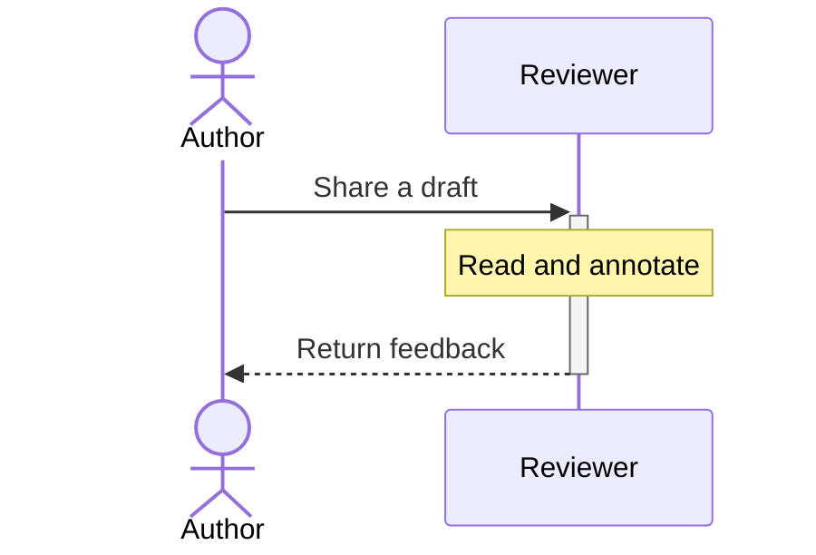

# TypeScript presentations

A Markdown deck you can run in your browser.

<!--
Press P to open the synchronized presenter window.
-->

---

# Write in Markdown

- Use headings, tables, links and speaker notes.
- Put shared images and fonts in the deck’s public directory.
- Add HTML for interaction and CSS for the deck’s theme.

<!--
The source of every slide is in this Markdown file.
-->

---

# Highlight code

```ts
const audience = ['designers', 'developers']
for (const person of audience) {
  console.log(`Hello, ${person}!`)
}
```

<!--
Code highlighting uses the TypeScript highlighter from Stacks.
-->

---
layout: center
routeAlias: reveal
transition: fade

---

# Introduce the idea

<ul>
  <li>Set up the first point.</li>
  <li v-click>Reveal the next point.</li>
  <li v-click>Finish with the decision.</li>
</ul>

<!--
Each press of the next arrow reveals a point.
[click]
Explain the second point.
[click]
Then ask for the decision.
-->

---

# A simple flowchart


<!--
The slide renders the diagram locally with ts-charts.
-->

---

# Live TypeScript

Edit the function and run it in the slide.

```ts {monaco-run}
const distance = (x: number, y: number) => Math.hypot(x, y)
console.log(distance(3, 4))
```

<!--
Change 3 or 4 and run the example again.
-->

---
layout: compare

---

# Vector length

The length of a vector \(v\) is \(\norm{v}\).

::right::

$$
\sqrt{x^2+y^2} = \sqrt{3^2+4^2} = 5
$$

[Browser runtime documentation](https://bun.com/docs/runtime)

<!--
Connect the formula to the preceding live example.
-->

---

# Exchange messages



<!--
Show how the participants, messages and note come from the diagram fence.
-->
