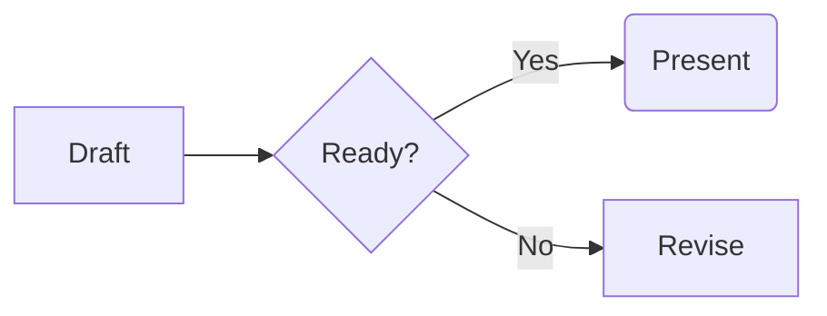

# TypeScript presentations

A Markdown deck you can run in your browser.

<!--
Press P to open the synchronized presenter window.
-->

---

# Write in Markdown

- Use headings, tables, links and speaker notes.
- Put shared images and fonts in the deck’s public directory.
- Add HTML for interaction and CSS for the deck’s theme.

<!--
The source of every slide is in this Markdown file.
-->

---

# Highlight code

```ts
const audience = ['designers', 'developers']
for (const person of audience) {
  console.log(`Hello, ${person}!`)
}
```

<!--
Code highlighting uses the TypeScript highlighter from Stacks.
-->

---
layout: center
routeAlias: reveal
transition: fade

---

# Introduce the idea

<ul>
  <li>Set up the first point.</li>
  <li v-click>Reveal the next point.</li>
  <li v-click>Finish with the decision.</li>
</ul>

<!--
Each press of the next arrow reveals a point.
[click]
Explain the second point.
[click]
Then ask for the decision.
-->

---

# A simple flowchart



<!--
The slide renders the diagram locally with ts-charts.
-->
